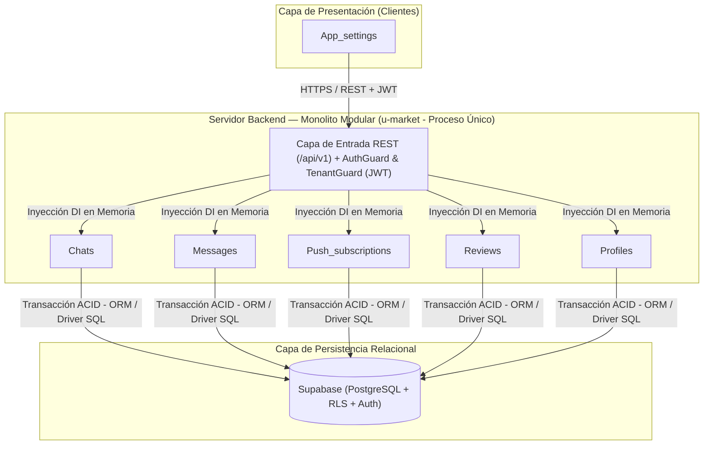
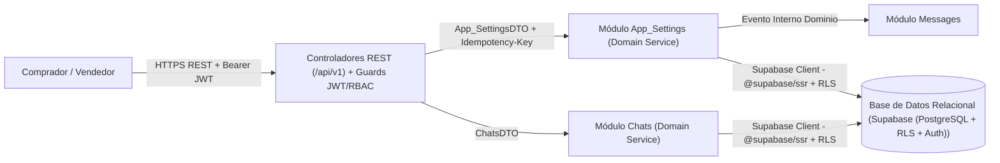
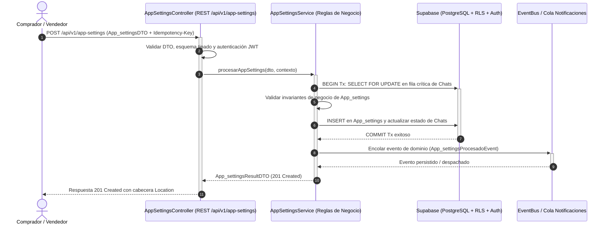
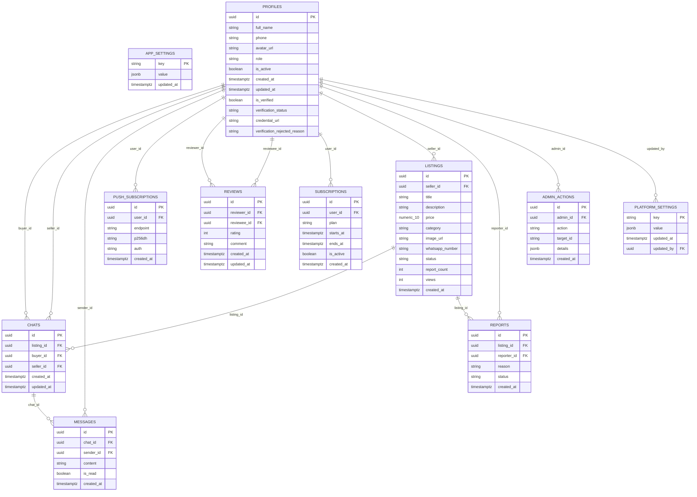
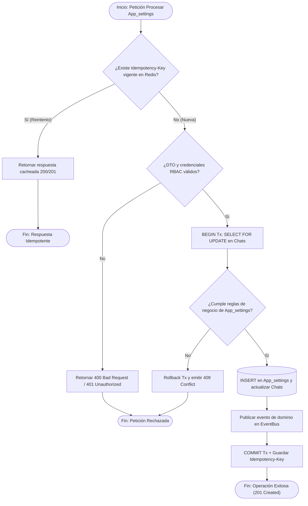

# Blueprint de Arquitectura: u-market

- **Fecha de diseño:** 2026-11-11 16:22
- **Arquitecta:** Gaby (Asistente de Arquitectura de Software de Alen)
- **Patrón Seleccionado:** **Monolito Modular (Modular Monolith)**
- **Stack Tecnológico Principal:** TypeScript / Next.js 16 (App Router) / React 19 / Supabase (PostgreSQL + Auth + RLS) / Tailwind CSS / PWA / S3 Compatible Storage

---

## 1. Visión y Contexto del Sistema
This is a [Next.js](https://nextjs.org) project bootstrapped with [`create-next-app`](https://nextjs.org/docs/app/api-reference/cli/create-next-app).

## Getting Started

First, run the development server:

```bash
npm run dev
# or
yarn dev
# or
pnpm dev
# or
bun dev
```

Open [http://localhost:3000](http://localhost:3000) with your browser to see the result.

You can start editing the page by modifying `app/page.tsx`. The page auto-updates as you edit the file.

This project uses [`next/font`](https://nextjs.org/docs/app/building-your-application/optimizing/fonts) to automatically optimize an

### ¿Por qué Monolito Modular (Modular Monolith)?
Unifica el despliegue en un solo proceso dividiendo el código en módulos de dominio independientes con bajo acoplamiento.

### Matriz de Decisión Arquitectónica (Evaluación Automática de 6 Patrones)

> **Veredicto del Motor Selector de Gaby:** Para un sistema transaccional multi-módulo sin microservicios pre-particionados, el **Monolito Modular** ofrece transacciones ACID inmediatas en una sola base de datos, llamadas en memoria con 0 ms de latencia de red y menor costo de infraestructura, manteniendo fronteras limpias por carpeta para extraer microservicios en el futuro solo si un módulo lo exige.

| Arquitectura Evaluada | Decisión | Justificación Técnica para `u-market` |
| :--- | :--- | :--- |
| **Monolito Modular (DDD Ligero)** | ✅ **SELECCIONADA POR GABY** | Para un sistema transaccional multi-módulo sin microservicios pre-particionados, el **Monolito Modular** ofrece transacciones ACID inmediatas en una sola base de datos, llamadas en memoria con 0 ms de latencia de red y menor costo de infraestructura, manteniendo fronteras limpias por carpeta para extraer microservicios en el futuro solo si un módulo lo exige. |
| **Monorepo de Microservicios + API Gateway (BFF)** | ❌ Descartada / Secundaria | *Excesivo si solo existe un único servidor monolítico sin separación de servicios.* (Se prefiere cuando: Ideal cuando coexisten múltiples apps (`apps/*`), microservicios (`services/*`) y paquetes compartidos (`packages/*`).) |
| **Clean Architecture / Hexagonal** | ❌ Descartada / Secundaria | *Añade exceso de interfaces y boilerplate si se fuerza en microservicios CRUD pequeños.* (Se prefiere cuando: Ideal para apps móviles (Flutter/Kotlin) y dominios bancarios/médicos que exigen aislar casos de uso de la BD/UI.) |
| **Arquitectura Orientada a Eventos (Pub/Sub)** | ❌ Descartada / Secundaria | *Complejidad innecesaria de consistencia eventual si el flujo principal es reserva/compra síncrona inmediata.* (Se prefiere cuando: Ideal para IoT, GPS en tiempo real, colas asíncronas, notificaciones masivas y streaming (Kafka/RabbitMQ).) |
| **Arquitectura en Capas (MVC + Service Layer)** | ❌ Descartada / Secundaria | *Se degrada rápido si hay múltiples dominios complejos acoplados en una sola carpeta `controllers/`.* (Se prefiere cuando: Ideal para portales web administrativos, PHP/Laravel o sistemas CRUD directos.) |
| **Microservicios Distribuidos Independientes** | ❌ Descartada / Secundaria | *Alto costo de DevOps, latencia de red y transacciones distribuidas (Sagas) para equipos pequeños.* (Se prefiere cuando: Ideal para organizaciones grandes con múltiples equipos autónomos y escalado independiente por contenedor.) |

---

## 2. Diagrama de Arquitectura de Componentes (Mermaid)



---

## 3. Topología de Interconexión y Matriz de Comunicación entre Servicios



### Matriz de Contratos y Protocolos de Integración

| Componente Origen | Componente Destino | Protocolo / Puerto | Contrato / Evento / DTO | Propósito de la Conexión |
| :--- | :--- | :--- | :--- | :--- |
| Comprador / Vendedor | Capa de Entrada REST (`/api/v1`) | HTTPS / TLS 1.3 (Puerto 443) | `Bearer JWT` + `Idempotency-Key` | Autenticación, validación de entrada y control de tasa |
| Controladores REST | Módulo App_Settings | Inyección DI en Memoria | DTOs de App_Settings | Ejecución de casos de uso y lógica de negocio |
| Módulo App_Settings | Módulo Messages | Eventos de Dominio en Memoria | Eventos de App_Settings | Encolado y despacho de notificaciones o efectos secundarios |
| Módulos de Dominio | Persistencia Relacional | TCP Pool Conexiones | Transacciones ACID | Almacenamiento seguro y consistencia de datos |

---

## 4. Ciclo de Vida y Diagrama de Secuencia en Tiempo Real (Mermaid)



---

## 5. Modelo de Datos y Diagrama Entidad-Relación (Mermaid)



---

## 6. Flujo Operativo y Toma de Decisiones (Mermaid)



---

## 7. Estructura de Directorios Recomendada

```text
proyecto/
├── src/
│   ├── index.ts
│   ├── config/
│   ├── shared/
│   └── modules/
│       ├── auth/
│       ├── core/
│       └── notifications/
├── prisma/
│   └── Supabase Client (@supabase/ssr + RLS)
├── tests/
└── package.json
```

---

## 8. Evaluación de Trade-offs (Concesiones de Arquitectura)

| Dimensión | Análisis Técnico |
| :--- | :--- |
| **Ventajas Clave** | Simplicidad operativa, latencia cero entre módulos en memoria, fácil refactorización y pruebas rápidas. |
| **Desventajas / Costos** | Comparte recursos de CPU/RAM en el mismo proceso; exige disciplina para respetar límites de módulos. |
| **Estrategia de Evolución** | Extraer un módulo a microservicio solo cuando requiera escalado de hardware independiente. |

---

## 9. Reglas de Gobernanza y Calidad
1. **Responsabilidad Única (SRP):** Ningún archivo o componente UI debe superar las 300-400 líneas.
2. **Cero Secretos en Código:** Credenciales, JWT secrets y URLs de conexión viven exclusivamente en `.env`.
3. **Falla Elegante y Trazabilidad:** Prohibido usar bloques `catch (err) {}` vacíos o tragar errores silenciosamente; emplear un middleware global de manejo de errores HTTP y logging estructurado.
4. **Desacoplamiento Controlador-BD:** Los controladores solo validan esquemas DTO (Zod / class-validator) y delegan en `services/`; nunca ejecutan lógica financiera ni confían en totales enviados por el cliente.

---

## 10. Auditoría Adversarial Red Team y Matriz ATAM (Contextual)

- **Proyecto Bajo Estrés:** `u-market`
- **Vectores de Dominio Activados Dinámicamente:** `transaccional_financiero_stock`, `sincronizacion_movil_offline`, `eventos_asincronia_notificaciones`, `nucleo_universal`
- **Componentes Auditados:** App_settings, Chats, Messages, Push_subscriptions, Reviews, Profiles

### A. Interrogatorio del Abogado del Diablo (Escenarios de Fallo en Producción)

1. **Doble Cobro por Timeout de Red e Integridad Transaccional (`Chats`):**
   - *Ataque Red Team:* ¿Qué ocurre si el cliente móvil o navegador pierde conexión justo tras enviar un pago/orden y reintenta la petición automáticamente 3 veces?
   - *Blindaje Aplicado:* Exigir cabecera `Idempotency-Key` única por operación financiera/orden almacenada con restricción `UNIQUE` y TTL, ejecutando el descuento de saldo/inventario dentro de una transacción ACID con bloqueo pesimista (`SELECT ... FOR UPDATE`) y `NUMERIC(12,2)` (jamás `FLOAT`).

2. **Degradación de Red en Clientes Móviles y Fugas de Ciclo de Vida (TypeScript / Next.js 16 (App Router) / React 19 / Supabase (PostgreSQL + Auth + RLS) / Tailwind CSS / PWA / S3 Compatible Storage):**
   - *Ataque Red Team:* ¿Qué sucede cuando la app móvil opera en redes 3G/4G inestables con reconexiones frecuentes o el usuario cierra pantallas con peticiones asíncronas en vuelo?
   - *Blindaje Aplicado:* Cola local persistente con reintentos exponenciales (*Exponential Backoff + Jitter*), versionado de API (`/api/v1/`) para retrocompatibilidad con apps ya instaladas, y liberación estricta de controladores/suscripciones (`dispose()` / `takeUntilDestroyed()`).

3. **Tormenta de Notificaciones Duplicadas y Caída de Workers Asíncronos:**
   - *Ataque Red Team:* Si el worker de notificaciones/eventos se reinicia a mitad de lote, ¿le enviará 5 correos/push repetidos al mismo usuario o bloqueará el hilo principal de la reserva/operación?
   - *Blindaje Aplicado:* Desacoplamiento mediante eventos de dominio (*Outbox Pattern*) fuera del camino crítico de respuesta HTTP y restricción `UNIQUE(entidad_id, tipo, canal)` para garantizar idempotencia estricta de envíos.

4. **Explosión de Consultas `N+1`, Borrado en Cascada Destructivo y Fuerza Bruta (TypeScript / Next.js 16 (App Router) / React 19 / Supabase (PostgreSQL + Auth + RLS) / Tailwind CSS / PWA / S3 Compatible Storage):**
   - *Ataque Red Team:* ¿Qué pasa si al borrar un usuario se dispara un `ON DELETE CASCADE` que destruye pagos o auditoría? ¿Qué ocurre si atacan `/auth/login` con 1,000 peticiones por segundo?
   - *Blindaje Aplicado:* Uso de `ON DELETE RESTRICT` o borrado lógico (`deleted_at` / `estado`) en entidades transaccionales/históricas, índices compuestos explícitos en todas las Foreign Keys de alta lectura, y *Rate Limiting* activo desde la Fase 1 en rutas de identidad.

### B. Verificación Cruzada de Entregables (Cross-Artifact Gate)
- [OK] **Stack Unificado:** Coherencia verificada para `TypeScript / Next.js 16 (App Router) / React 19 / Supabase (PostgreSQL + Auth + RLS) / Tailwind CSS / PWA / S3 Compatible Storage` sin fugas de tecnologías ajenas.
- [OK] **Integridad Referencial y Concurrencia:** Reglas de tipos estrictos, preservación histórica (`RESTRICT`) y códigos de conflicto (`409`) alineadas.
- [OK] **Contratos Orientados a Casos de Uso:** Endpoints diseñados alrededor de operaciones reales del dominio y no plantillas CRUD mudas.

### C. Matriz ATAM (*Architecture Tradeoff Analysis Method*)

| Atributo de Calidad | Opción A: CRUD Básico sin Blindaje | Opción B: **Monolito Modular (Modular Monolith)** + Blindaje Red Team (Seleccionada) | Opción C: Microservicios Distribuidos Prematuros |
| :--- | :--- | :--- | :--- |
| **Concurrencia e Integridad** | [X] Vulnerable a condiciones de carrera y registros duplicados | [OK] Garantizada en motor de BD (`EXCLUDE` / `FOR UPDATE` / `Idempotency`) | [!] Complejidad de transacciones distribuidas (Sagas / 2PC) |
| **Seguridad y Aislamiento** | [X] Vulnerable a IDOR y cabeceras manipulables | [OK] Guardias por contexto JWT, Rate Limiting Fase 1 y `RESTRICT` | [!] Mayor superficie de ataque entre redes internas |
| **Costo Operativo y Latencia** | [BAJO] Bajo costo, pero colapsa bajo carga concurrente | [OPTIMO] Llamadas en memoria, un solo despliegue y baja latencia | [ALTO] Alto costo de infraestructura y latencia de red innecesaria |
| **Mantenibilidad del Equipo** | [!] Deuda técnica rápida al crecer las reglas de negocio | [OK] Fronteras modulares limpias listas para escalar por fases | [ALTO] Sobrecarga de DevOps desproporcionada para la etapa actual |

### D. Reglas Innegociables de Blindaje para `u-market`
- [REGLA] Idempotencia obligatoria en pagos/órdenes (`Idempotency-Key`) y tipos monetarios `NUMERIC(12,2)` con `ON DELETE RESTRICT`.
- [REGLA] Tolerancia a desconexiones móviles con backoff exponencial, paginación cursor-based y versionado estricto `/api/v1/`.
- [REGLA] Idempotencia en colas/notificaciones mediante `UNIQUE(entidad_id, tipo, canal)` y procesamiento asíncrono fuera del request principal.
- [REGLA] Rate Limiting activo desde Fase 1 en autenticación, refresh tokens rotativos hasheados e índices compuestos en Foreign Keys.

---

## 11. Gobernanza QA (Pruebas de Regresión) y Asignación Inteligente de Desarrolladores (GitHub)

### 11.1 Matriz de Decisión de Pruebas de Regresión (*Risk-Based QA Testing*)

> **Criterio de Gobernanza QA de Gaby:** Las pruebas de regresión completas **NO se ejecutan a ciegas sobre todo el sistema**. Gaby aplica *Risk-Based Testing* para exigir regresión estricta en procesos transaccionales/financieros y eximir flujos informativos o cosméticos:

| Proceso / Módulo de `u-market` | Nivel de Riesgo | ¿Se Hace Prueba de Regresión? | Tipo de Prueba y Alcance | Justificación Técnica (Por qué Sí / Por qué No) |
| :--- | :--- | :--- | :--- | :--- |
| **Núcleo Transaccional, Auth y Pagos** | 🔴 **ALTO (Crítico)** | **SÍ — OBLIGATORIA (Bloqueante en CI/CD)** | Integración ACID + Seguridad JWT/Tenant + Idempotencia | Protege la integridad financiera, concurrencia y aislamiento de datos. |
| **App_settings (Flujo de Reserva/Pago)** | 🟡 **MEDIO (Flujo E2E Usuario)** | **PARCIAL — Solo Camino Feliz (Smoke E2E)** | Smoke Test E2E en Staging + Linter de Ciclo de Vida (`dispose` / `takeUntilDestroyed`) | Se prueba el flujo principal antes de release; cambios de diseño visual no bloquean el backend. |
| **Chats** | 🟡 **MEDIO (Módulo de Dominio)** | **PARCIAL — Selectiva (Unitaria)** | Pruebas Unitarias de Capa de Servicios | Se ejecuta únicamente si el PR modifica archivos dentro de este módulo. |
| **Messages** | 🟡 **MEDIO (Módulo de Dominio)** | **PARCIAL — Selectiva (Unitaria)** | Pruebas Unitarias de Capa de Servicios | Se ejecuta únicamente si el PR modifica archivos dentro de este módulo. |
| **Push_subscriptions** | 🟡 **MEDIO (Asíncrono / Integración)** | **PARCIAL — Selectiva (Con Mocks)** | Unitaria con Mock de FCM/SMTP/QR + Constraint `UNIQUE` de emisión | No se disparan correos/push reales en cada commit; solo se valida la generación de QR y que la cola no duplique envíos. |
| **Reviews** | 🟡 **MEDIO (Módulo de Dominio)** | **PARCIAL — Selectiva (Unitaria)** | Pruebas Unitarias de Capa de Servicios | Se ejecuta únicamente si el PR modifica archivos dentro de este módulo. |
| **Profiles** | 🟡 **MEDIO (Módulo de Dominio)** | **PARCIAL — Selectiva (Unitaria)** | Pruebas Unitarias de Capa de Servicios | Se ejecuta únicamente si el PR modifica archivos dentro de este módulo. |
| **Consultas Públicas de Solo Lectura (`/catalogo`, `/planes`, FAQs)** | 🟢 **BAJO (Sin Mutación de Estado)** | **NO — OPCIONAL (Excluida del Gate Diario)** | Verificación rápida de esquema HTTP `200 OK` | Son consultas `GET` idempotentes sin riesgo de corrupción de datos ni impacto financiero. |
| **Reportes Analíticos y Estadísticas (`/reportes/actividad`, `/reportes/rendimiento`)** | 🟢 **BAJO (Lectura Agregada)** | **NO — OPCIONAL (Solo antes de Release Mayor)** | Consulta SQL de muestreo en Staging | Un ajuste en métricas históricas no detiene la operación transaccional principal. |
| **Cambios Cosméticos de UI, Textos, Iconografía y Hojas de Estilo (CSS/SCSS)** | 🟢 **MÍNIMO (Visual / Estático)** | **NO — EXCLUIDO DE REGRESIÓN FUNCIONAL** | Linter Estático y revisión visual | No altera contratos de API ni persistencia de datos. |

### 11.2 Perfilado de Desarrolladores vía GitHub y Reparto Inteligente de Tareas

> **Motor de Asignación Basado en Evidencia (GitHub Skill Matrix):** Gaby inspecciona los repositorios de cada desarrollador (lenguajes predominantes, historial de repositorios, commits y contribuciones reales) para determinar en qué tecnología destaca cada miembro y asignarle el módulo exacto donde aportará mayor velocidad y menor tasa de bugs.

#### A. Matriz de Habilidades Detectadas en Repositorios de GitHub

| Desarrollador / Perfil | Fuente de Evidencia (Repositorios) | Tecnologías y Lenguajes Dominantes | Especialidad Determinada por Gaby |
| :--- | :--- | :--- | :--- |
| **@alenv514** | GitHub API (40 repositorios analizados: `f`, `ProyectoVisual`, `Agente-Ventas-y-Gestion-Conversacional`, `U-MARKKET`) | C# (5), TypeScript (4), JavaScript (4), HTML (4) | **Tech Lead / Arquitectura Backend, Seguridad RBAC, Agentes IA & Core Transaccional** |
| **Dev Backend / BD (Supervisado por @alenv514)** | Perfil requerido por análisis de repositorios del proyecto | TypeScript, Next.js 16 (App Router), Supabase Client (@supabase/ssr + RLS), PostgreSQL 16 (SQL/Triggers) | **Ingeniería Backend Transaccional, Concurrencia SQL y Pagos** |
| **Dev Mobile / Frontend (Célula Clientes)** | Perfil requerido por componentes de interfaz del Blueprint | TypeScript, React / Angular, Flutter / Dart | **Desarrollo de Clientes y Estado Reactivo** |
| **Dev QA Automatizado & DevSecOps** | Perfil complementario de calidad de software | Jest, Supertest, Postman, CI/CD | **Pruebas de Integración y Regresión Continua** |

#### B. Asignación de Módulos, Tecnologías y Esqueleto de Código Generable

| Módulo / Componente de Arquitectura | Responsable Recomendado | Stack y Tecnología Asignada | Esqueleto de Código que Gaby le Genera (`Scaffolding`) | Justificación Basada en Habilidades y Repositorios |
| :--- | :--- | :--- | :--- | :--- |
| **App_settings** | **@alenv514** | TypeScript / Next.js 16 (App Router) / React 19 / Supabase (PostgreSQL + Auth + RLS) / Tailwind CSS / PWA / S3 Compatible Storage | `src/app-settings/` (Controllers + Services + DTOs) | Asignado a @alenv514 por balanceo de carga técnica y especialización en el stack del proyecto. |
| **Chats** | **Dev Backend / BD (Supervisado por @alenv514)** | TypeScript / Next.js 16 (App Router) / React 19 / Supabase (PostgreSQL + Auth + RLS) / Tailwind CSS / PWA / S3 Compatible Storage | `src/chats/` (Controllers + Services + DTOs) | Asignado a Dev Backend / BD (Supervisado por @alenv514) por balanceo de carga técnica y especialización en el stack del proyecto. |
| **Messages** | **@alenv514** | TypeScript / Next.js 16 (App Router) / React 19 / Supabase (PostgreSQL + Auth + RLS) / Tailwind CSS / PWA / S3 Compatible Storage | `src/messages/` (Controllers + Services + DTOs) | Asignado a @alenv514 por balanceo de carga técnica y especialización en el stack del proyecto. |
| **Push_subscriptions** | **Dev Backend / BD (Supervisado por @alenv514)** | TypeScript / Next.js 16 (App Router) / React 19 / Supabase (PostgreSQL + Auth + RLS) / Tailwind CSS / PWA / S3 Compatible Storage | `src/push-subscriptions/` (Controllers + Services + DTOs) | Asignado a Dev Backend / BD (Supervisado por @alenv514) por balanceo de carga técnica y especialización en el stack del proyecto. |
| **Reviews** | **Dev QA Automatizado & DevSecOps** | TypeScript / Next.js 16 (App Router) / React 19 / Supabase (PostgreSQL + Auth + RLS) / Tailwind CSS / PWA / S3 Compatible Storage | `src/reviews/` (Controllers + Services + DTOs) | Asignado a Dev QA Automatizado & DevSecOps por balanceo de carga técnica y especialización en el stack del proyecto. |
| **Profiles** | **Dev Mobile / Frontend (Célula Clientes)** | TypeScript / Next.js 16 (App Router) / React 19 / Supabase (PostgreSQL + Auth + RLS) / Tailwind CSS / PWA / S3 Compatible Storage | `src/profiles/` (Controllers + Services + DTOs) | Asignado a Dev Mobile / Frontend (Célula Clientes) por balanceo de carga técnica y especialización en el stack del proyecto. |

---
> ✅ **[AUTO-CRÍTICA ARQUITECTÓNICA SUPERADA (Red Team Gate)]:** Coherencia verificada para stack **TypeScript / Next.js 16 (App Router) / React 19 / Supabase (PostgreSQL + Auth + RLS) / Tailwind CSS / PWA / S3 Compatible Storage** | Evidencia verificada en disco: `package.json` (`migration_student_verification.sql`, `supabase_chat_schema.sql`, `supabase_push.sql`, `supabase_reputation.sql`, `supabase_schema.sql`, 11 tablas reales) | Cero librerías de terceros en deuda técnica | Prioridad por severidad validada.
