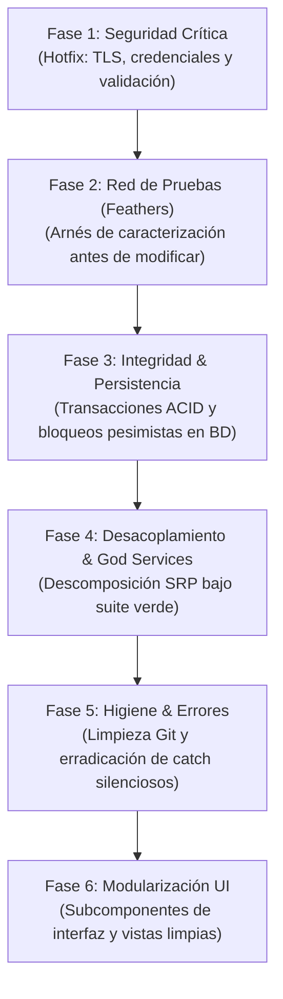

# Hoja de Ruta de Refactorización Profesional: u-market

- **Fecha de Auditoría:** 2026-11-11 16:26
- **Arquitecta de Software:** Gaby (Asistente de Arquitectura de Alen)
- **Stack Detectado:** TypeScript / Next.js 16 (App Router) / React 19 / Supabase (PostgreSQL + Auth + RLS) / Tailwind CSS / PWA / S3 Compatible Storage
- **Escala Real:** 71 archivos de código fuente (excluyendo artefactos de compilación y librerías externas) | 13,268 líneas de código
- **Salud Arquitectónica Inicial:** **39/100** *(Puntaje ponderado: 100 base - deducciones por vulnerabilidades de seguridad, monolitos >800L, acoplamiento de persistencia y excepciones silenciosas)*
- **Principio Rector:** Prioridad técnica por severidad real y Ley de Feathers (Seguridad y Arnés de Pruebas ANTES que modificaciones de persistencia o cosmética).

---

## 1. Diagnóstico Real y Métricas Verificables

Métricas correspondientes **exclusivamente al código fuente propio del proyecto** (descartando librerías de terceros en `vendor/`, `assets/`, plugins y artefactos de compilación):

### A. Seguridad y Autorización (Severidad 1 - Crítica)
- ✓ No se detectaron secretos ni riesgos críticos de seguridad inmediatos.

### B. Integridad de Negocio y Persistencia (Severidad 2 - Alta)
- ✓ Capas de persistencia desacopladas o sin acoplamiento severo detectado.
- **Manejo de Errores y Excepciones:** 0 bloques genéricos o silenciosos detectados.

### C. Higiene de Repositorio y Git (Severidad 3 - Media)
- ⚠️ Working tree con 1 cambios sin commitear (no está limpio)

### D. Monolitos y Complejidad Estructural (Deuda Técnica Principal Activa — Prioridad Alta)
**Archivos Monolíticos Críticos (>800 líneas):**
- 🛑 `src/app/admin/page.tsx (1312 líneas - Deuda técnica alta)`
- 🛑 `src/components/SplashCursor.tsx (934 líneas - Deuda técnica alta)`
- 🛑 `src/components/Navbar.tsx (869 líneas - Deuda técnica alta)`

**Archivos en Alerta de Tamaño (>300 líneas):**
- ⚠️ `src/app/profile/page.tsx (742 líneas)`
- ⚠️ `src/app/register/page.tsx (671 líneas)`
- ⚠️ `src/app/listings/new/page.tsx (550 líneas)`
- ⚠️ `src/app/listings/[id]/edit/page.tsx (488 líneas)`
- ⚠️ `src/app/page.tsx (427 líneas)`
- ⚠️ `src/app/listings/[id]/ListingDetailClient.tsx (418 líneas)`
- ⚠️ `src/components/LightRays.tsx (415 líneas)`
- ⚠️ `src/app/globals.css (364 líneas)`
- ⚠️ `supabase_schema.sql (336 líneas)`
- ⚠️ `src/app/dashboard/page.tsx (331 líneas)`

---

## 2. Hoja de Ruta por Fases: Estrategia de Refactorización TypeScript / Next.js 16 (App Router) / React 19 / Supabase (PostgreSQL + Auth + RLS) / Tailwind CSS / PWA / S3 Compatible Storage



---

### Fase 1: Seguridad Crítica Inmediata (Hotfix)
- **Prioridad:** 🔴 **CRÍTICA (Severidad 1)** — Riesgo activo de compromiso o fuga de credenciales.
- **Acciones Técnicas:**
  1. **[✅ DIAGNÓSTICO DE SEGURIDAD LIMPIO]:** No se detectaron secretos en texto plano en archivos de configuración ni bypasses de certificados TLS/autorización activos.
  2. **Mantenimiento Preventivo:** Conservar credenciales y claves exclusivamente en variables de entorno o gestores de secretos fuera de Git.
- **Criterio de Terminado (Definition of Done):**
  - Verificación continua sin secretos ni bypasses TLS en el repositorio.
- **Riesgo & Rollback:**
  - *Riesgo:* Fallos de autenticación o conexión si no se configuran correctamente las credenciales locales.
  - *Mitigación:* Proveer archivos de plantilla de entorno y verificar conexiones antes del despliegue.

---

### Fase 2: Red de Seguridad de Tests (Test Harness OBLIGATORIO)
- **Prioridad:** 🟠 **ALTA (Severidad 2 - Ley de Feathers)** — Sin pruebas automatizadas de caracterización, cualquier refactorización posterior corrompe el comportamiento en producción.
- **Acciones Técnicas:**
  1. **Ley de Feathers (Arnés de Caracterización Obligatorio):** Antes de refactorizar los módulos críticos detectados (`src/app/admin/page.tsx, src/components/SplashCursor.tsx, src/components/Navbar.tsx, src/app/profile/page.tsx`), asegurar la línea base ejecutable (`npm run lint && npm run build`).
  2. Garantizar que el linter, el tipado estático y la compilación/pruebas pasen al 100% antes y después de cada extracción de componente o servicio.
- **Criterio de Terminado (Definition of Done):**
  - Ejecución de `npm run lint && npm run build` pasando al 100% como arnés de verificación inmutable garantizando cero regresiones.
- **Riesgo & Rollback:**
  - *Riesgo:* Tests inestables o que dependen de infraestructura externa.
  - *Mitigación:* Usar mocks en memoria o contenedores locales efímeros para garantizar determinismo.

---

### Fase 3: Integridad del Negocio y Persistencia
- **Prioridad:** 🟠 **ALTA (Severidad 3)** — Prevención de datos corruptos, integridad referencial, políticas de acceso en BD y control de concurrencia.
- **Acciones Técnicas:**
  1. Organizar el esquema SQL extenso detectado (`supabase_schema.sql`) en archivos de migración modulares y versionados (`01_tablas_base.sql`, `02_politicas_rls.sql`, `03_funciones_triggers.sql`) para facilitar el mantenimiento evolutivo.
  2. Mantener las invariantes de negocio (límites de precios, roles, estados y cuotas) aplicadas directamente en la base de datos (`CHECK`, `UNIQUE`, políticas RLS y funciones RPC en `Supabase Client (@supabase/ssr + RLS)`).
- **Criterio de Terminado (Definition of Done):**
  - Esquema `supabase_schema.sql` modularizado en migraciones versionadas con políticas y restricciones activas.
- **Riesgo & Rollback:**
  - *Riesgo:* Deadlocks en la base de datos si los bloqueos abarcan operaciones lentas.
  - *Mitigación:* Delimitar transacciones y bloqueos estrictamente a las operaciones de escritura críticas y liberarlos antes de llamadas de red externas.

---

### Fase 4: Desacoplamiento de Capas y God Services
- **Prioridad:** 🟡 **MEDIA (Severidad 4)** — Mantenibilidad y cumplimiento de separación de responsabilidades (SRP) bajo pruebas en verde.
- **Acciones Técnicas:**
  1. Extraer las consultas directas a datos y la lógica de estado de negocio incrustada dentro de las páginas/componentes extensos (`src/app/admin/page.tsx, src/components/SplashCursor.tsx, src/components/Navbar.tsx, src/app/profile/page.tsx`) hacia *custom hooks* (`useAdminActions`, `useProfileData`) y servicios de dominio dedicados (`src/lib/services/`).
  2. Verificar con `npm run lint && npm run build` que cada extracción mantenga intactos los tipos y el comportamiento actual.
- **Criterio de Terminado (Definition of Done):**
  - Páginas y componentes (`src/app/admin/page.tsx, src/components/SplashCursor.tsx, src/components/Navbar.tsx`) libres de consultas directas acopladas; lógica delegada a hooks/servicios de dominio.
- **Riesgo & Rollback:**
  - *Riesgo:* Ruptura de contratos o inyecciones de dependencias circulares.
  - *Mitigación:* Ejecutar la suite de pruebas de la Fase 2 en cada cambio puntual.

---

### Fase 5: Higiene de Repositorio y Manejo de Errores
- **Prioridad:** 🟡 **MEDIA (Severidad 5)** — Erradicación de errores silenciosos (`catch` vacíos/null) y working tree limpio para CI/CD.
- **Acciones Técnicas:**
  1. Working tree con 1 cambios sin commitear (no está limpio).
- **Criterio de Terminado (Definition of Done):**
  - Índice de Git limpio (0 artefactos rastreados) y cero bloques catch que silencien excepciones sin contexto.
- **Riesgo & Rollback:**
  - *Riesgo:* Excepciones previamente silenciadas que ahora emergen a la superficie.
  - *Mitigación:* Capturar mediante manejador centralizado de errores y registrar contexto en el logger estructurado del stack.

---

### Fase 6: Descomposición de Monolitos UI y Modularización de Vistas
- **Prioridad:** 🔴 **ALTA (Prioridad Principal de Refactorización — Deuda Técnica #1 Activa)** — Los archivos de interfaz y páginas detectados (`src/app/admin/page.tsx, src/components/SplashCursor.tsx, src/components/Navbar.tsx, src/app/profile/page.tsx`) concentran la mayor complejidad estructural del proyecto (>700–1,300 líneas) y deben intervenirse de forma prioritaria.
- **Acciones Técnicas:**
  1. Trocear prioritariamente los componentes y páginas monolíticas detectadas (`src/app/admin/page.tsx, src/components/SplashCursor.tsx, src/components/Navbar.tsx, src/app/profile/page.tsx, src/app/register/page.tsx, src/app/listings/new/page.tsx`) en subcomponentes cohesivos por sección funcional (tablas, modales, filtros, menús y tarjetas) de menos de 300 líneas.
  2. Extraer lógica de presentación repetida y estados de formulario hacia hooks y componentes reutilizables.
- **Criterio de Terminado (Definition of Done):**
  - Monolitos UI (`src/app/admin/page.tsx, src/components/SplashCursor.tsx, src/components/Navbar.tsx`) descompuestos en subcomponentes modulares (<300–350 líneas) con responsabilidad visual única.
- **Riesgo & Rollback:**
  - *Riesgo:* Inconsistencias visuales o desalineación de estilos.
  - *Mitigación:* Validar manualmente las pantallas principales y aplicar CSS modular.

---

## 3. Matriz de Gobernanza y Criterios de Aceptación (DoD)

| Fase | Severidad | Criterio de Aceptación (DoD) | Plan de Rollback |
| :--- | :--- | :--- | :--- |
| **Fase 1: Seguridad** | 🔴 Crítica | Verificación continua sin secretos ni bypasses TLS en el repositorio. | Restaurar variables locales desde .env.backup. |
| **Fase 2: Red de Seguridad de Tests** | 🟠 Alta (Feathers) | Ejecución de `npm run lint && npm run build` pasando al 100% como arnés de verificación inmutable garantizando cero regresiones. | Desactivar suite de tests temporalmente |
| **Fase 3: Integridad** | 🟠 Alta | Esquema `supabase_schema.sql` modularizado en migraciones versionadas con políticas y restricciones activas. | Revertir commit de capa de datos. |
| **Fase 4: Desacoplamiento de Capas** | 🟡 Media | Páginas y componentes (`src/app/admin/page.tsx, src/components/SplashCursor.tsx, src/components/Navbar.tsx`) libres de consultas directas acopladas; lógica delegada a hooks/servicios de dominio. | Mantener servicios previos |
| **Fase 5: Higiene** | 🟡 Media | Índice de Git limpio (0 artefactos rastreados) y cero bloques catch que silencien excepciones sin contexto. | Ninguno (operación de configuración Git) |
| **Fase 6: Descomposición de Monolitos UI** | 🔴 Alta (Deuda #1 Activa) | Monolitos UI (`src/app/admin/page.tsx, src/components/SplashCursor.tsx, src/components/Navbar.tsx`) descompuestos en subcomponentes modulares (<300–350 líneas) con responsabilidad visual única. | Restaurar vistas desde control de versiones |

---

## 4. Protocolo de Ejecución con Git Estándar

Para ejecutar esta hoja de ruta de forma impecable sin alterar tu rama principal, utiliza el flujo estándar de Git:

1. **Aislar en rama de trabajo:**
   ```bash
   git checkout -b refactor/modularizar-ui-monolitos
   ```
2. **Aplicar los cambios de la fase.**
3. **Validar con pruebas:**
   ```bash
   npm run lint && npm run build
   ```
4. **Registrar commit atómico por fase:**
   ```bash
   git add <archivos_modificados>
   git commit -m "refactor(ui): descomponer monolitos de interfaz en subcomponentes y hooks de dominio"
   ```
5. **Avanzar ordenadamente a la siguiente fase.**

---
> ✅ **[AUTO-CRÍTICA ARQUITECTÓNICA SUPERADA (Red Team Gate)]:** Coherencia verificada para stack **TypeScript / Next.js 16 (App Router) / React 19 / Supabase (PostgreSQL + Auth + RLS) / Tailwind CSS / PWA / S3 Compatible Storage** | Evidencia verificada en disco: `package.json` (`migration_student_verification.sql`, `supabase_chat_schema.sql`, `supabase_push.sql`, `supabase_reputation.sql`, `supabase_schema.sql`, 11 tablas reales) | Cero librerías de terceros en deuda técnica | Prioridad por severidad validada.
