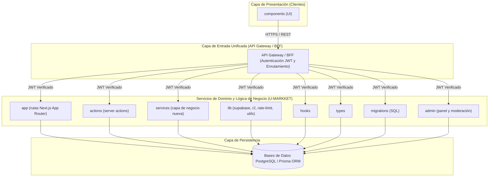

# Blueprint de Arquitectura: U-MARKKET

- **Fecha de diseño:** 2026-10-22 09:09
- **Arquitecta:** Gaby (Asistente de Arquitectura de Software de Alen)
- **Patrón Seleccionado:** **Monolito Modular (Modular Monolith)**
- **Stack Tecnológico Principal:** TypeScript / Node.js / Next.js / Prisma

---

## 1. Visión y Contexto del Sistema
Marketplace universitario con autenticación, perfiles de usuario, anuncios (listings) con imágenes, chat interno, reseñas con reputación, verificación de estudiantes y panel de administración con moderación. Construido con Next.js App Router + React + TypeScript, Supabase (Auth, PostgreSQL con RLS, Storage) y Cloudflare R2 para imágenes. Objetivo del plan: reducir deuda técnica (salud 44/100) sin cambiar el stack, dividiendo archivos monolíticos y ordenando capas.

### ¿Por qué Monolito Modular (Modular Monolith)?
Unifica el despliegue en un solo proceso dividiendo el código en módulos de dominio independientes con bajo acoplamiento.

---

## 2. Diagrama de Arquitectura de Componentes (Mermaid)



---

## 3. Estructura de Directorios Recomendada

```text
proyecto/
├── src/
│   ├── index.ts
│   ├── config/
│   ├── shared/
│   └── modules/
│       ├── auth/
│       ├── core/
│       └── notifications/
├── prisma/
│   └── schema.prisma
├── tests/
└── package.json
```

---

## 4. Evaluación de Trade-offs (Concesiones de Arquitectura)

| Dimensión | Análisis Técnico |
| :--- | :--- |
| **Ventajas Clave** | Simplicidad operativa, latencia cero entre módulos en memoria, fácil refactorización y pruebas rápidas. |
| **Desventajas / Costos** | Comparte recursos de CPU/RAM en el mismo proceso; exige disciplina para respetar límites de módulos. |
| **Estrategia de Evolución** | Extraer un módulo a microservicio solo cuando requiera escalado de hardware independiente. |

---

## 5. Reglas de Gobernanza y Calidad
1. **Responsabilidad Única (SRP):** Ningún archivo o componente UI debe superar las 300-400 líneas.
2. **Cero Secretos en Código:** Credenciales, JWT secrets y URLs de conexión viven exclusivamente en `.env`.
3. **Falla Elegante y Trazabilidad:** Prohibido usar bloques `catch (err) {}` vacíos o tragar errores silenciosamente; emplear un middleware global de manejo de errores HTTP y logging estructurado.
4. **Desacoplamiento Controlador-BD:** Los controladores Express/Next.js solo validan esquemas (Zod) y delegan en `services/`; nunca ejecutan lógica financiera ni confían en totales enviados por el cliente.
